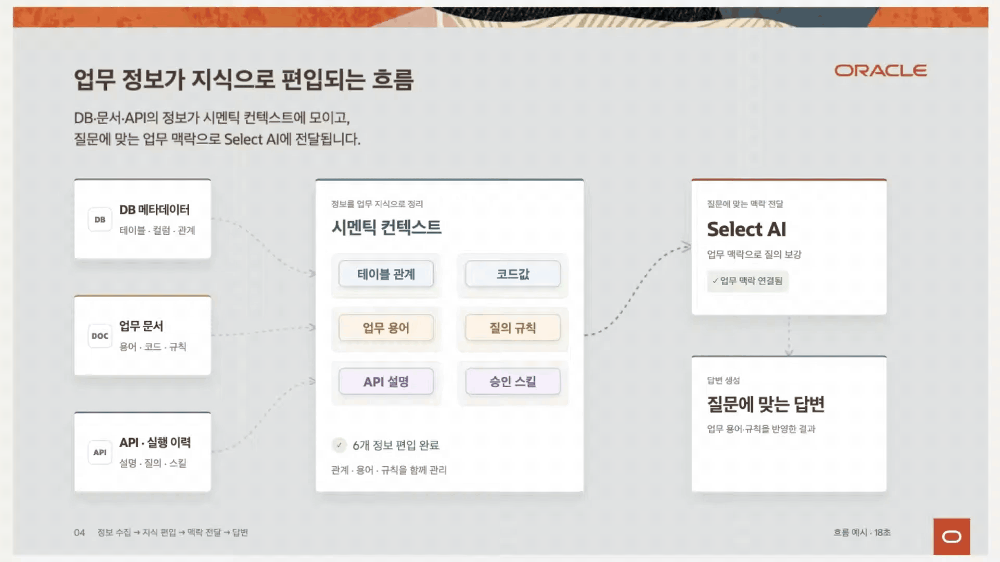

# Redwood HTML Animation Kit

시나리오와 사진으로 HTML 장표를 만들고, 내용을 수정해 발표하거나 MP4·SRT로 저장하는 도구입니다. 제목·목차·핵심 내용·스크립트는 JSON으로 관리하고, Codex·Claude가 템플릿과 공통 기능을 이용해 실제 페이지를 제작합니다. 별도로 표지·간지·마지막 장을 포함한 예제 13장과 효과 33종을 제공합니다.

[](assets/preview-current.gif)

## 실행

Python 3가 있으면 별도 설치 없이 실행할 수 있습니다.

```sh
python3 start.py
```

브라우저에서 `http://127.0.0.1:4173`을 엽니다. 이미 사용 중인 포트라면 `python3 start.py --port 4174`를 사용합니다. 종료는 터미널에서 Ctrl+C입니다.
HTML 파일을 직접 더블 클릭하면 모듈 로딩이 제한될 수 있으므로 로컬 서버로 실행합니다.

## 시나리오·사진으로 장표 만들기

상단 **장표 만들기** 또는 `http://127.0.0.1:4173/builder.html`을 엽니다.

1. 시나리오와 사진, 원하는 페이지 표현을 입력하고 **내용·스크립트 초안 만들기**를 누릅니다. 기본 초안에는 API 키가 필요하지 않습니다. **LLM으로 내용 정리**는 선택 사항입니다.
2. 목록에서 페이지를 골라 제목·목차·핵심 내용·스크립트와 제작 요청을 수정합니다. 이때 보이는 본문은 제작 전 기본 초안입니다.
3. **Codex·Claude 제작용 ZIP**을 내려받아 압축을 풉니다. JSON·사진·템플릿·공통 코드·`AGENTS.md`·`CLAUDE.md`·`REQUEST.md`를 포함하며 `.env`와 키는 제외합니다.
4. Codex나 Claude에서 압축을 푼 폴더를 열고 다음과 같이 요청합니다.

   > AGENTS.md와 REQUEST.md를 읽고 이 발표를 제작해 주세요. 템플릿을 유지하면서 내용에 맞게 표·그림·SVG·화면 효과를 만들고, 실제 브라우저에서 모든 페이지를 검수해 주세요.

5. 제작한 폴더에서 `python3 start.py --no-browser`를 실행하고 표시된 주소를 엽니다. **발표 시작**, **발표자 보기**, **영상·SRT**는 제작한 페이지 코드를 공통 재생기로 실행합니다.

페이지 화면은 `pages/*.js`에서 작성하므로 고정 레이아웃 종류로 제한하지 않습니다. 제목·목차·핵심 내용·스크립트·사진은 `presentation-project.json`, 코드 연결은 `authored-pages.js`에서 관리합니다. JSON을 불러온다는 이유로 외부 코드를 실행하지 않습니다. 상세한 제작·검수 계약은 [Codex·Claude 제작 지침](authoring/AUTHORING.md)과 [모듈 설계](docs/agent-authoring-design.md)에 있습니다.

**JSON 저장**은 내용과 사진을 전달합니다. 완성한 페이지 코드를 포함하려면 제작용 프로젝트 폴더 전체를 보관해야 합니다. 편집 화면에서 바꾼 내용을 파일에도 유지하려면 JSON을 저장해 프로젝트의 `presentation-project.json`을 교체합니다. 파일의 JSON 변경 후에는 서버를 재시작하고 페이지를 새로고침합니다.

LLM 내용 정리는 `.env`의 OpenAI 호환 설정으로 시나리오와 사진 파일명을 제공자에 전송합니다. 사진 내용 인식은 포함하지 않습니다. 이미지 입력은 PNG·JPEG·WebP, 최대 20개·각 5MB·전체 25MB이며 문서는 최대 60장입니다. ZIP 생성에는 외부 모델을 사용하지 않습니다.

기존 JSON 문서는 기본 레이아웃으로 계속 표시할 수 있습니다. 형식은 [프로젝트 JSON 예제](examples/presentation-project.json)와 [JSON Schema](schemas/presentation-project.schema.json)를 참조하세요. 제작 요청은 문서의 `brief`와 페이지의 `design`에 기록합니다.

제공된 Redwood POTX의 표지(6장), 목차 강조 간지(34~35장), 본문 영역(19~21장), 마지막 장(46장)을 공통 템플릿으로 사용합니다. 표지·간지·마지막 장과 글꼴·로고·색상·여백은 유지하고, 본문은 사용자의 요청에 맞춰 제작합니다.

## 발표 시작과 발표자 보기

청중용 장표와 발표 대본을 서로 다른 창에 띄워 발표할 수 있습니다.

| 창 | 표시 내용 | 배치 |
| --- | --- | --- |
| 발표 창 | 장표만 표시. 주소줄·탭·즐겨찾기 막대 없음 | 청중이 보는 모니터·프로젝터 |
| 발표자 보기 | 현재/다음 장표, 발표 노트, 경과 시간·시계 | 발표자 노트북·보조 모니터 |

### 발표 순서

`python3 start.py`로 실행하고, 로컬에 Microsoft Edge 또는 Google Chrome이 설치되어 있어야 합니다. macOS에서는 Edge를 먼저 사용하며, 없으면 Chrome을 사용합니다. 모니터는 같은 화면을 복제하는 미러링 대신 **확장 모드**로 연결합니다.

1. 브라우저에서 시작할 장표를 선택하고 **발표 시작**을 누릅니다.
2. 장표가 별도 발표 창으로 열립니다. 이 창을 청중용 화면으로 옮기고 크기를 맞춥니다.
3. **새 발표 창** 오른쪽 위의 **발표자 보기**를 누르거나 **S** 키를 누릅니다. 버튼은 흐리게 표시되며 마우스를 올리면 진해집니다.
4. 열린 발표자 창을 발표자용 화면에 둡니다.
5. 발표자 창을 선택하고 **← / →** 키로 이동합니다. 발표 창의 장표와 발표 노트가 함께 바뀝니다. 경과 시간은 타이머를 클릭하면 초기화됩니다.
6. 종료할 때 발표자 창과 발표 창을 닫습니다. 로컬 서버는 실행한 터미널에서 **Ctrl+C**로 종료합니다.

발표 창은 앱 모드로 열린 **크기 조절 가능한 일반 창**입니다. OS 전체 화면이나 키오스크 모드가 아니므로 다른 창과 함께 사용할 수 있습니다. 처음에는 현재 화면의 사용 가능한 영역 크기로 열도록 요청하며, 최종 크기와 위치는 브라우저·OS가 조정할 수 있습니다.

기존 브라우저 탭에서 연 발표자 보기는 그 탭을 조종합니다. 청중용 발표 창을 조종하려면 반드시 **새 발표 창에서** 발표자 보기를 여세요.

### 발표 대본 수정

`index.html`에서 해당 장표의 `data-notes` 내용을 바꿉니다. 기본 예제 노트가 각 장표에 들어 있습니다.

```html
<section id="cover" class="slide rf-slide bookend-slide cover-slide"
         data-notes="발표 제목과 발표자를 소개합니다.">
  <!-- 장표 내용 -->
</section>
```

수정 후 발표 창을 새로고침합니다. 노트는 청중용 장표에는 표시되지 않지만 HTML 소스에는 포함되므로, 공유본에 비공개 대본을 넣지 않습니다.
발표자 보기의 장표 미리보기는 애니메이션의 마지막 배치를 보여줍니다. 청중 화면의 애니메이션 재생 위치를 실시간으로 복제하지는 않습니다.

### 창이 열리지 않을 때

- **발표 시작이 실패하면:** `start.py` 서버로 실행했는지, 로컬에 Edge 또는 Chrome이 설치되어 있는지 확인합니다. 업데이트 전에 켜 둔 서버라면 Ctrl+C로 종료한 뒤 다시 실행합니다. HTML 직접 열기나 일반 정적 파일 서버로는 발표 창을 열 수 없습니다.
- **발표자 창이 안 열리면:** 이 로컬 사이트의 팝업을 허용하고, 발표 창에서 S 키를 다시 누릅니다.
- **청중 화면이 안 바뀌면:** 발표자 창이 청중용 발표 창에서 열린 것인지 확인합니다. 기존 브라우저 탭에서 열었다면 닫고 청중용 발표 창에서 다시 엽니다.

## 영상과 SRT 자막 저장

장표 화면의 **영상 내보내기**를 열면 포함할 장표와 발표 노트·자막을 편집해 무음 MP4(1920×1080, 30fps)로 저장할 수 있습니다. **SRT만 저장**은 영상 녹화 없이 자막 파일을 내려받습니다.

1. 장표를 선택하고 발표 노트를 수정합니다. **노트로 자막 초안** 또는 **LLM으로 자막 초안**을 누른 뒤 자막 문구·시작·끝 시각을 편집합니다.
2. 기본으로 켜진 **화면·자막 최소 시간 자동 확보**는 본문 분량·구성요소 수·마지막 요소의 등장 후 확인 시간과 자막 읽기 시간을 고려합니다. 자막은 공백 제외 초당 6자와 0.6초 여유, 최소 2초라는 추정 기준을 사용합니다. 필요한 경우 장표·애니메이션·자막 시간을 함께 늘리며, 편집 화면에 실제 적용 시간을 표시합니다. 직접 맞춘 시간을 쓰려면 자동 옵션을 끕니다.
3. **SRT만 저장**을 누르면 선택한 장표의 순서와 늘어난 시간을 적용한 SRT를 받습니다. **편집 설정 저장/불러오기**로 작업을 이어갈 수 있습니다.
4. 영상은 자막 표시·선택형 자막·자막 없이 중 방식을 선택하고 **영상 만들기**를 누릅니다. 공유 창에서 현재 **영상 내보내기 탭**을 선택하고 녹화가 끝날 때까지 유지합니다. 완료 후 MP4와 SRT를 저장합니다.

영상 녹화에는 최신 Edge/Chrome, MP4 변환에는 로컬 FFmpeg가 필요합니다(`brew install ffmpeg`). SRT만 저장할 때는 FFmpeg와 API 키가 필요하지 않습니다. 전체 영상은 자동 조정 후 10분 이내이며, 현재 음성 합성은 포함하지 않습니다. 읽기 시간은 음성 분석 결과가 아닌 편집용 추정치입니다.

LLM 초안은 `.env.example`을 참고해 `.env`에 `OPENAI_API_KEY`, `OPENAI_BASE_URL`, `OPENAI_MODEL`을 설정합니다. 기존 `OPENROUTER_API` 키도 지원합니다. 서버 실행 중 설정을 바꿔도 다음 요청에 반영됩니다. **LLM으로 자막 초안**을 누를 때만 선택한 장표의 제목·본문·발표 노트·애니메이션 등장 시각을 설정한 제공자에 전송합니다. 이미지 자체를 분석하지 않으므로 그림 안에만 있는 설명은 발표 노트에 적어 주세요. LLM이 제안한 설명과 시각은 확인 후 수정할 수 있습니다.

공통 모듈과 입력 계약은 [영상 내보내기 설계](docs/video-export-design.md)에 정리되어 있습니다.

## 샘플

| 페이지 | 내용 |
| --- | --- |
| 표지 | POTX 패턴 테두리·제목·발표자 자리 |
| 목차형 간지 3장 | 구성 예제·애니메이션 효과·차트로 넘어갈 때 해당 항목 강조 |
| 지식관리 구성 | 3개 영역 등장·깊이·순차 강조 |
| 정보 흐름 | DB·문서·API → 시멘틱 컨텍스트 → 질의·답변 |
| 기본 효과 | 등장·퇴장·순차 등장·강조·펄스·펼침 |
| 동작 효과 | 확대·바운스·뒤집기·회전·고무줄·흔들기 |
| 텍스트 | 글자·단어·줄 등장·타이핑·스크램블·웨이브 |
| SVG | 선 그리기·흐름·변형·경로·궤도·체크 |
| 수치·배치 | 숫자 증가/감소·진행률·재배치·카드 확장 |
| 차트 | 막대·선·도넛, 데모 데이터 |
| 마지막 장 | POTX 좌우 분할·감사 문구·발표자 자리 |

왼쪽 목차로 이동하고, 각 재생 버튼으로 효과를 비교합니다. ‘마지막 장면’은 애니메이션 최종 상태를 표시합니다.
문서가 숨겨지면 일시정지합니다. OS 동작 줄이기가 켜져 있으면 최종 상태를 표시합니다.

공통 디자인 부품은 `http://127.0.0.1:4173/components.html`에서 선택합니다. HTML 예제를 펼쳐 클래스 구조를 확인할 수 있습니다.

## 수정과 재사용

| 위치 | 역할 |
| --- | --- |
| `index.html`, `slides/` | 내용과 페이지별 타이밍·데이터 |
| `style.css`, `components.css` | 페이지 배치 |
| `framework/src/` | 공통 동작 원본 |
| `framework/ui/` | 공통 CSS 토큰·컴포넌트 원본 |
| `vendor/` | 실행에 필요한 로컬 라이브러리 |

기본 실행에는 npm과 인터넷이 필요하지 않습니다. 공통 모듈을 수정해 다시 빌드할 때만 Node.js 22.12 이상과 아래 명령이 필요합니다.

```sh
npm ci
npm run build:framework
npm run check
```

- [공통 HTML·CSS 사용법](docs/html-ui.md)
- [구성과 설계](docs/design.md)
- [검증 범위](docs/validation.md)
- [공통 모듈 빌드](framework/README.md)

## 출처와 사용 범위

Redwood 웹사이트와 사용자 제공 PPT 템플릿을 참고했습니다. Oracle 공식 JET 컴포넌트와 동일한 구현은 아닙니다.
Oracle Sans가 로컬에 있으면 장표에 사용하며, 없으면 시스템 글꼴로 대체합니다. 폰트 파일과 전체 PPT 템플릿은 포함하지 않습니다.

reveal.js 5.2.1과 Anime.js 4.5.0은 MIT 라이선스이며 각 `vendor/` 하위에 원문이 있습니다.
Oracle 브랜드 이미지에는 이 오픈소스 라이선스가 적용되지 않습니다. [자산 출처](assets/REDWOOD-SOURCE.txt)를 확인하세요.
