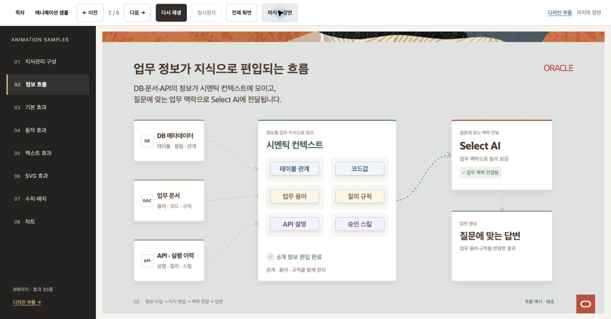

# Redwood HTML Animation Kit

애니메이션 장표와 웹 화면에서 재사용할 수 있는 HTML·CSS·JavaScript 예제입니다. 8개 페이지에 효과 33종과 공통 디자인 부품을 제공합니다.



## 실행

Python 3가 있으면 별도 설치 없이 실행할 수 있습니다.

```sh
python3 start.py
```

브라우저에서 `http://127.0.0.1:4173`을 엽니다. 이미 사용 중인 포트라면 `python3 start.py --port 4174`를 사용합니다. 종료는 터미널에서 Ctrl+C입니다.
HTML 파일을 직접 더블 클릭하면 모듈 로딩이 제한될 수 있으므로 로컬 서버로 실행합니다.

## 샘플

| 페이지 | 내용 |
| --- | --- |
| 지식관리 구성 | 3개 영역 등장·깊이·순차 강조 |
| 정보 흐름 | DB·문서·API → 시멘틱 컨텍스트 → 질의·답변 |
| 기본 효과 | 등장·퇴장·순차 등장·강조·펄스·펼침 |
| 동작 효과 | 확대·바운스·뒤집기·회전·고무줄·흔들기 |
| 텍스트 | 글자·단어·줄 등장·타이핑·스크램블·웨이브 |
| SVG | 선 그리기·흐름·변형·경로·궤도·체크 |
| 수치·배치 | 숫자 증가/감소·진행률·재배치·카드 확장 |
| 차트 | 막대·선·도넛, 데모 데이터 |

왼쪽 목차로 이동하고, 각 재생 버튼으로 효과를 비교합니다. ‘마지막 장면’은 애니메이션 최종 상태를 표시합니다.
‘전체 화면’은 장표만 표시하고 Esc로 종료합니다. Edge/macOS에서 탭이 남으면 View의 ‘Always Show Toolbar in Full Screen’을 확인하고, 필요하면 Control+Command+F로 창 전체 화면을 전환합니다.
문서가 숨겨지면 일시정지합니다. OS 동작 줄이기가 켜져 있으면 최종 상태를 표시합니다.

공통 디자인 부품은 `http://127.0.0.1:4173/components.html`에서 선택합니다. HTML 예제를 펼쳐 클래스 구조를 확인할 수 있습니다.

## 수정과 재사용

| 위치 | 역할 |
| --- | --- |
| `index.html`, `slides/` | 내용과 페이지별 타이밍·데이터 |
| `style.css`, `components.css` | 페이지 배치 |
| `framework/src/` | 공통 동작 원본 |
| `framework/ui/` | 공통 CSS 토큰·컴포넌트 원본 |
| `vendor/` | 실행에 필요한 로컬 라이브러리 |

기본 실행에는 npm과 인터넷이 필요하지 않습니다. 공통 모듈을 수정해 다시 빌드할 때만 Node.js 22.12 이상과 아래 명령이 필요합니다.

```sh
npm ci
npm run build:framework
npm run check
```

- [공통 HTML·CSS 사용법](docs/html-ui.md)
- [구성과 설계](docs/design.md)
- [검증 범위](docs/validation.md)
- [공통 모듈 빌드](framework/README.md)

## 출처와 사용 범위

Redwood 웹사이트와 사용자 제공 PPT 템플릿을 참고했습니다. Oracle 공식 JET 컴포넌트와 동일한 구현은 아닙니다.
Oracle Sans가 로컬에 있으면 장표에 사용하며, 없으면 시스템 글꼴로 대체합니다. 폰트 파일과 전체 PPT 템플릿은 포함하지 않습니다.

reveal.js 5.2.1과 Anime.js 4.5.0은 MIT 라이선스이며 각 `vendor/` 하위에 원문이 있습니다.
Oracle 브랜드 이미지에는 이 오픈소스 라이선스가 적용되지 않습니다. [자산 출처](assets/REDWOOD-SOURCE.txt)를 확인하세요.
