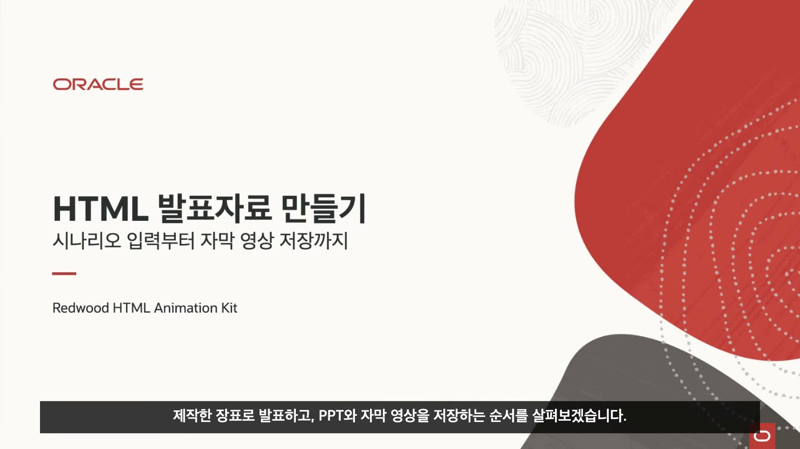

# Redwood HTML Animation Kit

시나리오와 사진으로 HTML 장표를 만들고, 내용을 수정해 발표하거나 PPTX·MP4·SRT로 저장하는 도구입니다. 제목·목차·핵심 내용·스크립트는 JSON으로 관리하고, Codex·Claude가 템플릿과 공통 기능을 이용해 실제 페이지를 제작합니다. Oracle Corporate 템플릿의 밝은·어두운 테마를 선택할 수 있으며, 표지·간지·마지막 장을 포함한 예제 13장과 효과 33종을 제공합니다.

현재 공개 버전은 **v0.1.0-alpha.2**입니다. [변경 사항과 검증 범위](./docs/releases/v0.1.0-alpha.2.md)를 확인하세요. Mac Chrome·PowerPoint에서 검증했으며 파일 더블클릭과 Windows 동작은 추가 검증이 필요합니다.

[](./docs/media/usage-demo.mp4)

[사용법 영상 보기 · MP4 3.72MB](./docs/media/usage-demo.mp4) · [SRT 자막](./docs/media/usage-demo.srt) — 3분 15초 · 1080p · 30fps · 한글 자막 포함 · 무음

## 사용법 데모

이 키트로 만든 11장 안내 자료로 시나리오 입력 → Codex·Claude 본문 제작 → AI 수정 → 발표자 보기 → PPT·자막 영상 저장을 살펴볼 수 있습니다. 실제 화면과 공통 표·SVG 차트·등장 효과를 사용합니다.

`python3 start.py`로 서버를 실행한 뒤 [`http://127.0.0.1:4173/examples/usage-demo/open.html`](http://127.0.0.1:4173/examples/usage-demo/open.html)을 엽니다. **데모 장표 열기**는 새 프로젝트 복사본을 만들며 AI 모델을 호출하지 않습니다. Python과 Git이 필요합니다. 포트를 바꿨다면 주소의 포트도 맞추세요.

제목·스크립트와 본문 원본은 [사용법 데모 소스](./examples/usage-demo/README.md)에서 수정할 수 있습니다. 이 데모도 장표의 **PPT·영상·SRT**에서 영상으로 저장합니다.

## 애니메이션 샘플

기존 **13장·33종**은 첫 화면 `index.html`의 연결과 **애니메이션 샘플** 링크에서 엽니다. 더블클릭용 카탈로그는 `examples/animations/samples.html`, 디자인 부품은 `examples/components/standalone.html`입니다. 제작용·발표용 ZIP에도 두 카탈로그를 포함합니다. 샘플의 **추가 기능** 메뉴에서 테마·마지막 장면·PPT/영상 내보내기·장표 만들기·디자인 부품을 엽니다.

## 발표용 배포본 열기

배포 ZIP을 풀고 **index.html을 더블클릭**합니다. 발표 내용·스타일·실행 스크립트는 HTML에 포함되며 영상·스크린샷은 옆의 폴더에서 읽습니다. ZIP 안에서 바로 열지 말고 전체를 풀어 같은 폴더 구조로 보관하세요. 인터넷 영상은 네트워크가 필요합니다.

발표용 HTML에서 목차·상세 이동·찾기·효과 재생·증거 확대·영상·발표자 보기를 사용합니다. AI 편집·이력 관리·영상 변환은 아래 서버 방식으로 실행합니다. 파일로 직접 열었을 때의 발표자 창 연결은 브라우저별 확인이 필요합니다.

## 편집·고급 기능 실행

Python 3가 있으면 별도 설치 없이 실행할 수 있습니다.

```sh
python3 start.py
```

브라우저에서 `http://127.0.0.1:4173`을 엽니다. 이미 사용 중인 포트라면 `python3 start.py --port 4174`를 사용합니다. 종료는 터미널에서 Ctrl+C입니다.
저장소의 편집 화면은 모듈을 읽으므로 로컬 서버로 실행합니다. 앞의 발표용 배포 ZIP에 포함된 `index.html`과 구분하세요.

## AI로 장표 수정하기

발표용 HTML의 **AI 편집**에서 사용할 AI를 선택합니다. Python이 실행 전이면 같은 폴더의 시작 파일을 더블클릭합니다. Python 3가 필요하며, 명령어를 직접 입력하지 않아도 됩니다.

| 선택 | Mac 시작 파일 | Windows 시작 파일 |
| --- | --- | --- |
| OpenAI 호환 API | `AI/start-openai.command` | `AI/start-openai.cmd` |
| OCI CLI | `AI/start-oci.command` | `AI/start-oci.cmd` |
| 설치된 Codex | `AI/start-codex.command` | `AI/start-codex.cmd` |
| 설치된 Claude | `AI/start-claude.command` | `AI/start-claude.cmd` |

`AI/start.command` 또는 `AI/start.cmd`를 실행한 뒤 열린 창에서 AI를 선택해도 됩니다. 시작 파일은 빈 로컬 포트에서 Python 보조 서버와 AI 설정 화면을 엽니다. HTML 버튼 자체가 Python을 실행하지는 않습니다. 이미 실행 중이면 발표용 HTML의 **실행 중인 AI 편집에 연결**로 현재 장표를 전달하고, 열린 창의 **현재 발표 AI 편집**으로 이동합니다. 편집 후 ZIP을 다시 저장하면 발표용 HTML에도 변경이 반영됩니다. 종료는 Python 실행 창에서 Ctrl+C입니다.

발표 화면의 **AI 편집**에서 변경 요청을 입력하고 **편집안 만들기 → 변경 미리보기 → 적용**으로 수정합니다. 선택한 장표의 제목·본문·스크립트, 표·SVG 도식·사진 배치·등장 효과를 수정하며 공통 표지·간지·로고·글꼴은 유지합니다. 본문은 HTML/SVG와 공통 애니메이션으로 구성하며 AI가 반환한 JavaScript는 실행하지 않습니다.

연결 방식은 세 가지입니다.

저장한 연결 선택이 없으면 설치된 **Codex를 우선 선택**합니다. 이번 사진·그림·차트·효과 생성 시험에서는 Codex가 7/7 적용됐고, 작은 API 모델은 형식 오류가 많았습니다. 이는 해당 시험의 결과이며 모든 요청의 성공을 보장하지 않습니다. 기존 선택은 유지합니다. nano 등 기존 연결을 바꾸려면 **기본 연결로 변경**을 누르거나 연결 방식·모델을 직접 고르세요. CLI의 모델 칸을 비우면 해당 CLI의 기본 모델을 사용하며, `.env`의 API 모델을 자동으로 상향하지 않습니다.

- **OpenAI 호환 API**: 서버의 `.env`에 있는 `OPENAI_API_KEY`, `OPENAI_BASE_URL`, `OPENAI_MODEL`을 사용합니다. 모델을 편집창에서 바꿀 수도 있습니다.
- **OCI CLI**: 설치된 `oci`와 기존 설정을 사용합니다. 프로파일·리전·모델 ID·컴파트먼트 이름 또는 OCID를 입력하고 모델에 맞게 Generic 또는 Cohere 형식을 선택합니다. 기본값은 `.env.example`의 `OCI_AI_*` 항목으로 지정할 수 있습니다. [OCI chat 명령](https://docs.oracle.com/en-us/iaas/tools/oci-cli/latest/oci_cli_docs/cmdref/generative-ai-inference/chat-result/chat.html)의 온디맨드 모델을 사용합니다.
- **설치된 Codex·Claude**: 감지된 프로그램을 선택합니다. 해당 CLI의 로그인과 모델 사용 권한이 필요합니다. 별도 임시 폴더에서 편집 응답을 받아 같은 검증·미리보기·적용 절차를 거칩니다. 설치 감지는 실제 인증 성공을 의미하지 않습니다.

선택한 제공자에 장표 내용·현재 페이지 코드·수정 요청·목차·작성 원칙을 전달합니다. 사진 원본·API 키·`.env`는 편집 자료에 포함하지 않습니다. 호출에는 선택한 제공자의 요금·이용 한도가 적용됩니다. 장표 편집·목차 초안·자막 초안은 모두 같은 AI 연결 선택을 사용합니다. 선택은 브라우저에 보관하며 API 키는 서버의 `.env`에서만 읽습니다.

**변경 이력**에서 요청 문구·시간·버전과 선택한 장표의 썸네일을 확인합니다. 썸네일을 누르면 저장 당시 화면을 확대합니다. 화면은 편집 시작·적용 시 1280×720 PNG로 보관하며, 캡처가 없는 과거 버전은 **저장된 화면 없음**으로 표시합니다. **비교**는 이전 원본과 현재 원본을 현재 렌더러로 나란히 보여 줍니다. **복원**은 스크린샷이 아닌 원본 내용을 새 버전으로 저장합니다. 이력과 캡처는 Git이 설치된 로컬 서버의 `.presentation-ai/<프로젝트 ID>/`에 보관하며 템플릿 GitHub에는 올라가지 않습니다. 다른 창에서 변경한 경우 오래된 편집안·저장을 거절합니다.

새로 만든 자료는 **프로젝트 ZIP 저장**으로 더블클릭 발표용 `index.html`, 실행 코드와 AI 본문까지 보관할 수 있습니다. 기존 사용자 페이지 코드가 있는 제작 폴더는 폴더 전체 또는 실행본 ZIP으로 전달합니다. JSON 저장만으로 AI 본문과 버전 이력까지 옮기지는 않습니다. 버전 이력까지 보관하려면 `.presentation-ai`도 함께 백업하세요. 외부 Codex·Claude에서 직접 고친 파일 전체의 이력은 해당 제작 폴더의 Git으로 별도 관리합니다.

## 시나리오·사진으로 장표 만들기

상단 **장표 만들기** 또는 `http://127.0.0.1:4173/builder.html`을 엽니다.

1. 시나리오와 사진, 원하는 페이지 표현을 입력하고 **내용·스크립트 초안 만들기**를 누릅니다. 기본 초안에는 API 키가 필요하지 않습니다. **LLM으로 내용 정리**는 선택 사항입니다.
2. 목록에서 페이지를 골라 제목·목차·핵심 내용·스크립트와 제작 요청을 수정합니다. 이때 보이는 본문은 제작 전 기본 초안입니다.
3. **Codex·Claude 제작용 ZIP**을 내려받아 압축을 풉니다. JSON·사진·템플릿·공통 코드·`AGENTS.md`·`CLAUDE.md`·`REQUEST.md`를 포함하며 `.env`와 키는 제외합니다.
4. Codex나 Claude에서 압축을 푼 폴더를 열고 다음과 같이 요청합니다.

   > AGENTS.md와 REQUEST.md를 읽고 이 발표를 제작해 주세요. 템플릿을 유지하면서 내용에 맞게 표·그림·SVG·화면 효과를 만들고, 실제 브라우저에서 모든 페이지를 검수해 주세요.

5. 제작한 폴더에서 `python3 start.py --no-browser`를 실행하고 표시된 주소를 엽니다. **발표 시작**, **발표자 보기**, **PPT·영상·SRT**는 제작한 페이지 코드를 공통 재생기로 실행합니다.

페이지 화면은 `pages/*.js`에서 작성하므로 고정 레이아웃 종류로 제한하지 않습니다. 제목·목차·핵심 내용·스크립트·사진은 `presentation-project.json`, 코드 연결은 `authored-pages.js`에서 관리합니다. JSON을 불러온다는 이유로 외부 코드를 실행하지 않습니다. 상세한 제작·검수 계약은 [Codex·Claude 제작 지침](./authoring/AUTHORING.md)과 [모듈 설계](./docs/agent-authoring-design.md)에 있습니다.

모든 발표의 기획·작성·검수에는 [발표 장표 작성 원칙과 통과 기준](./authoring/SLIDE_PRINCIPLES.md)을 적용합니다. 해당 원칙은 제작용 ZIP에도 포함됩니다.

**JSON 저장** 또는 **Ctrl/Cmd+S**로 내용 JSON을 내려받습니다. **Ctrl/Cmd+F**로 제목·본문·스크립트를 찾습니다. 제작 폴더에서 편집한 내용은 같은 프로젝트의 원본 JSON에도 자동 반영됩니다. 완성본은 코드·증거·로컬 영상을 포함한 ZIP으로 전달할 수 있습니다. [본문 데이터·증거·동영상·완성본 ZIP 사용법](./docs/presentation-workspace.md)을 참고하세요.

LLM 내용 정리는 `.env`의 OpenAI 호환 설정으로 시나리오와 사진 파일명을 제공자에 전송합니다. 사진 내용 인식은 포함하지 않습니다. 이미지 입력은 PNG·JPEG·WebP, 최대 20개·각 5MB·전체 25MB이며 문서는 최대 60장입니다. ZIP 생성에는 외부 모델을 사용하지 않습니다.

기존 JSON 문서는 기본 레이아웃으로 계속 표시할 수 있습니다. 형식은 [프로젝트 JSON 예제](./examples/presentation-project.json)와 [JSON Schema](./schemas/presentation-project.schema.json)를 참조하세요. 제작 요청은 문서의 `brief`와 페이지의 `design`에 기록합니다.

사용자 제공 Oracle Corporate PPT Template의 밝은·어두운 표지(18~19장), 간지(51~52장), 본문(72·87장), 마지막 장(121~122장)을 공통 템플릿으로 사용합니다. 문서 기본 테마와 장표별 테마를 선택할 수 있습니다. 표지·간지·마지막 장과 글꼴·로고·색상·여백은 유지하고 본문은 사용자 요청에 맞춰 제작합니다.

## 발표 시작과 발표자 보기

청중용 장표와 발표 대본을 서로 다른 창에 띄워 발표할 수 있습니다.

| 창 | 표시 내용 | 배치 |
| --- | --- | --- |
| 발표 창 | 장표 표시. 브라우저·창 방식에 따라 주소줄 표시 | 청중이 보는 모니터·프로젝터 |
| 발표자 보기 | 현재/다음 장표, 발표 노트, 경과 시간·시계 | 발표자 노트북·보조 모니터 |

### 발표 순서

`python3 start.py`로 실행합니다. 기본은 **현재 브라우저**의 별도 팝업 창입니다. 설치된 Chrome/Edge 앱 창은 선택 옵션입니다. 모니터는 같은 화면을 복제하는 미러링 대신 **확장 모드**로 연결합니다.

1. 브라우저에서 시작할 장표를 선택하고 **발표 시작**을 누릅니다.
2. 장표가 별도 발표 창으로 열립니다. 이 창을 청중용 화면으로 옮기고 크기를 맞춥니다.
3. **새 발표 창** 오른쪽 위의 **발표자 보기**를 누르거나 **S** 키를 누릅니다. 버튼은 흐리게 표시되며 마우스를 올리면 진해집니다.
4. 열린 발표자 창을 발표자용 화면에 둡니다.
5. 발표자 창을 선택하고 **← / →** 키로 이동합니다. 발표 창의 장표와 발표 노트가 함께 바뀝니다. 경과 시간은 타이머를 클릭하면 초기화됩니다.
6. 종료할 때 발표자 창과 발표 창을 닫습니다. 로컬 서버는 실행한 터미널에서 **Ctrl+C**로 종료합니다.

발표 창은 **크기 조절 가능한 일반 창**입니다. 기본 팝업은 브라우저 정책에 따라 주소줄이 남을 수 있으며, 도구 막대를 숨긴 앱 창이 필요하면 창 옵션에서 Chrome/Edge를 선택합니다. OS 전체 화면이나 키오스크 모드가 아니므로 다른 창과 함께 사용할 수 있습니다. 처음에는 현재 화면의 사용 가능한 영역 크기로 열도록 요청하며, 최종 크기와 위치는 브라우저·OS가 조정할 수 있습니다.

기존 브라우저 탭에서 연 발표자 보기는 그 탭을 조종합니다. 청중용 발표 창을 조종하려면 반드시 **새 발표 창에서** 발표자 보기를 여세요.

### 발표 대본 수정

제작한 문서는 편집 화면의 발표 스크립트 또는 JSON의 `notes`를 수정합니다. 기본 13장 예제는 `examples/animations/index.html`에서 해당 장표의 `data-notes` 내용을 바꿉니다. 기본 예제 노트가 각 장표에 들어 있습니다.

```html
<section id="cover" class="slide rf-slide bookend-slide cover-slide"
         data-notes="발표 제목과 발표자를 소개합니다.">
  <!-- 장표 내용 -->
</section>
```

수정 후 발표 창을 새로고침합니다. 노트는 청중용 장표에는 표시되지 않지만 HTML 소스에는 포함되므로, 공유본에 비공개 대본을 넣지 않습니다.
제작한 문서의 발표자 보기에서는 현재 장표의 재생 위치와 앞·뒤 단계 이동을 청중 창과 동기화합니다. 기본 13장 예제의 미리보기는 마지막 배치를 표시합니다.

### 창이 열리지 않을 때

- **발표 시작이 실패하면:** 이 사이트의 팝업 허용 여부와 새 창의 오류를 확인합니다. 앱 창 옵션에서는 `start.py` 실행과 해당 Chrome/Edge 설치가 필요합니다. 업데이트 전에 켜 둔 서버라면 Ctrl+C로 종료한 뒤 다시 실행합니다. 앱 창 옵션은 일반 정적 파일 서버에서 지원하지 않습니다.
- **발표자 창이 안 열리면:** 이 로컬 사이트의 팝업을 허용하고, 발표 창에서 S 키를 다시 누릅니다.
- **청중 화면이 안 바뀌면:** 발표자 창이 청중용 발표 창에서 열린 것인지 확인합니다. 기존 브라우저 탭에서 열었다면 닫고 청중용 발표 창에서 다시 엽니다.

## PowerPoint로 저장

**PPT·영상·SRT → PPT 저장 방식**에서 선택하고 **PPT 저장**을 누릅니다. 포함한 장표 순서와 편집한 발표 노트를 PPTX로 저장합니다. API 키·FFmpeg·별도 설치가 필요하지 않습니다.

- **화면 모양 유지**: 장표의 마지막 장면을 3200×1800 이미지로 저장합니다. 글꼴 모양과 배치를 그대로 보관하며 개별 텍스트·표 편집은 지원하지 않습니다.
- **편집 가능**: 텍스트·표·기본 SVG 도형·이미지를 개별 PowerPoint 요소로 저장합니다. 복잡한 그래픽과 캔버스는 그림으로 유지합니다. HTML과 PowerPoint의 텍스트 배치가 다를 수 있으므로 내려받은 파일에서 확인하세요.

영문·숫자는 Oracle Sans Tab, 한글은 HTML과 같은 대체 글꼴을 지정합니다. Oracle Sans Tab이 없는 환경에서는 설치된 글꼴로 대체합니다. 폰트 파일은 포함하지 않으므로 다른 PC에서 편집형을 열 때는 지정된 글꼴이 필요합니다. 애니메이션·동영상은 정지 화면으로 저장합니다.

## 영상과 SRT 자막 저장

장표 화면의 **영상 내보내기**를 열면 포함할 장표와 발표 노트·자막을 편집해 무음 MP4(1920×1080, 30fps)로 저장할 수 있습니다. **SRT만 저장**은 영상 녹화 없이 자막 파일을 내려받습니다.

1. 장표를 선택하고 발표 노트를 수정합니다. **노트로 자막 초안** 또는 **LLM으로 자막 초안**을 누른 뒤 자막 문구·시작·끝 시각을 편집합니다.
2. 기본으로 켜진 **화면·자막 최소 시간 자동 확보**는 본문 분량·구성요소 수·마지막 요소의 등장 후 확인 시간과 자막 읽기 시간을 고려합니다. 자막은 공백 제외 초당 6자와 0.6초 여유, 최소 2초라는 추정 기준을 사용합니다. 필요한 경우 장표·애니메이션·자막 시간을 함께 늘리며, 편집 화면에 실제 적용 시간을 표시합니다. 직접 맞춘 시간을 쓰려면 자동 옵션을 끕니다.
3. **SRT만 저장**을 누르면 선택한 장표의 순서와 늘어난 시간을 적용한 SRT를 받습니다. **편집 설정 저장/불러오기**로 작업을 이어갈 수 있습니다.
4. 영상은 자막 표시·선택형 자막·자막 없이 중 방식을 선택하고 **영상 만들기**를 누릅니다. 공유 창에서 현재 **영상 내보내기 탭**을 선택하고 녹화가 끝날 때까지 유지합니다. 완료 후 MP4와 SRT를 저장합니다.

녹화 시 포인터 제외를 요청하며 브라우저가 지원하지 않으면 포인터가 포함될 수 있습니다.

영상 녹화에는 최신 Edge/Chrome, MP4 변환에는 로컬 FFmpeg가 필요합니다(`brew install ffmpeg`). SRT만 저장할 때는 FFmpeg와 API 키가 필요하지 않습니다. 전체 영상은 자동 조정 후 10분 이내이며, 현재 음성 합성은 포함하지 않습니다. 읽기 시간은 음성 분석 결과가 아닌 편집용 추정치입니다.

LLM 초안은 `.env.example`을 참고해 `.env`에 `OPENAI_API_KEY`, `OPENAI_BASE_URL`, `OPENAI_MODEL`을 설정합니다. 기존 `OPENROUTER_API` 키도 지원합니다. 서버 실행 중 설정을 바꿔도 다음 요청에 반영됩니다. **LLM으로 자막 초안**을 누를 때만 선택한 장표의 제목·본문·발표 노트·애니메이션 등장 시각을 설정한 제공자에 전송합니다. 이미지 자체를 분석하지 않으므로 그림 안에만 있는 설명은 발표 노트에 적어 주세요. LLM이 제안한 설명과 시각은 확인 후 수정할 수 있습니다.

본문에는 로컬 MP4·WebM과 YouTube를 임베드할 수 있습니다. 로컬 영상 구간은 장표의 재생시간에 반영됩니다. 현재 내보내기는 영상 오디오를 포함하지 않으며, YouTube 장표는 MP4 녹화에서 제외해야 합니다. [동영상 등록과 재생 조건](./docs/presentation-workspace.md#동영상)을 참고하세요.

공통 모듈과 입력 계약은 [영상 내보내기 설계](./docs/video-export-design.md)에 정리되어 있습니다.

## 샘플

| 페이지 | 내용 |
| --- | --- |
| 표지 | Corporate 패턴·제목·발표자 자리 |
| 목차형 간지 3장 | 구성 예제·애니메이션 효과·차트로 넘어갈 때 해당 항목 강조 |
| 지식관리 구성 | 3개 영역 등장·깊이·순차 강조 |
| 정보 흐름 | DB·문서·API → 시멘틱 컨텍스트 → 질의·답변 |
| 기본 효과 | 등장·퇴장·순차 등장·강조·펄스·펼침 |
| 동작 효과 | 확대·바운스·뒤집기·회전·고무줄·흔들기 |
| 텍스트 | 글자·단어·줄 등장·타이핑·스크램블·웨이브 |
| SVG | 선 그리기·흐름·변형·경로·궤도·체크 |
| 수치·배치 | 숫자 증가/감소·진행률·재배치·카드 확장 |
| 차트 | 막대·선·도넛, 데모 데이터 |
| 마지막 장 | Corporate 그래픽·감사 문구·발표자 자리 |

왼쪽 목차로 이동하고, 각 재생 버튼으로 효과를 비교합니다. ‘마지막 장면’은 애니메이션 최종 상태를 표시합니다.
문서가 숨겨지면 일시정지합니다. OS 동작 줄이기가 켜져 있으면 최종 상태를 표시합니다.

공통 디자인 부품은 `http://127.0.0.1:4173/components.html`에서 선택합니다. HTML 예제를 펼쳐 클래스 구조를 확인할 수 있습니다.

## 수정과 재사용

| 위치 | 역할 |
| --- | --- |
| `examples/animations/` | 애니메이션 샘플과 페이지별 타이밍·데이터 |
| `app/` | 편집·발표·내보내기·AI 화면과 호스트 연결 |
| `framework/src/` | 공통 동작 원본 |
| `framework/ui/` | 공통 CSS 토큰·컴포넌트 원본 |
| `vendor/` | 실행에 필요한 로컬 라이브러리 |
| `templates/` | 현재 Oracle Corporate 템플릿, `legacy/`의 이전 스타일 |
| `examples/usage-demo/` | 사용법 장표 원본·화면 캡처·데모 열기 |
| `assets/`, `docs/media/` | 발표 공통 자산, README 소개 영상·자막 |
| `tests/` | 자동 검사, `browser/`의 실제 화면 검사 |
| `scripts/` | 빌드·가져오기·ZIP 제작 도구 |
| `AI/` | 사용자용 AI 연결 시작 파일 |
| `dist/` | 생성한 ZIP·영상. Git 제외 |

루트에는 실행 진입점과 프로젝트 설정을 둡니다. 기존 `/builder.html`·`/deck.html`·`/export.html` 주소도 Python 서버에서 새 `app/` 경로로 연결합니다. 전체 구조와 ZIP 포함 범위는 [저장소 구성](docs/design.md)을 참고하세요.

기본 실행에는 npm과 인터넷이 필요하지 않습니다. 공통 모듈을 수정해 다시 빌드할 때만 Node.js 22.12 이상과 아래 명령이 필요합니다.

```sh
npm ci
npm run build:framework
npm run check
```

- [공통 HTML·CSS 사용법](./docs/html-ui.md)
- [구성과 설계](./docs/design.md)
- [검증 범위](./docs/validation.md)
- [알파 이후 개선 순서와 배포본 검수](./docs/alpha-roadmap.md)
- [공통 모듈 빌드](./framework/README.md)

## 출처와 사용 범위

Redwood 웹사이트와 사용자 제공 PPT 템플릿을 참고했습니다. Oracle 공식 JET 컴포넌트와 동일한 구현은 아닙니다.
Oracle Sans Tab이 로컬에 있으면 장표에 사용하며, 없으면 시스템 글꼴로 대체합니다. 폰트 파일과 전체 PPT 템플릿은 포함하지 않습니다.

reveal.js 5.2.1과 Anime.js 4.5.0은 MIT 라이선스이며 각 `vendor/` 하위에 원문이 있습니다.
Oracle 브랜드 이미지에는 이 오픈소스 라이선스가 적용되지 않습니다. [자산 출처](./assets/REDWOOD-SOURCE.txt)를 확인하세요.
